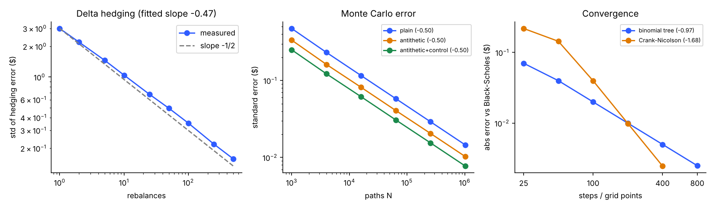

# optionlab

Option pricing three independent ways (closed form, Monte Carlo, binomial tree and Crank-Nicolson finite differences) plus a **delta-hedging simulator**, with every claim checked by a test or an experiment. The goal is to see numerically how pricing methods converge and what hedging a short option actually costs.



## What's here

| Module | What it does |
|---|---|
| `optionlab/bs.py` | Black-Scholes-Merton price, Greeks (delta, gamma, vega, theta, rho), implied volatility (Newton with bisection fallback and no-arbitrage bounds check) |
| `optionlab/mc.py` | Monte Carlo under GBM with antithetic variates and a control variate, returns price and standard error |
| `optionlab/lattice.py` | Cox-Ross-Rubinstein tree (European and American) and Crank-Nicolson solver for the Black-Scholes PDE |
| `optionlab/hedge.py` | Discrete delta hedging of a short call: rebalancing frequency, wrong-volatility hedging, proportional transaction costs |
| `run_experiments.py` | Runs every experiment, writes `results/results.json` |

## Results (all numbers from `results/results.json`)

Base case: S = K = 100, T = 1, r = 5%, sigma = 20%, European call = **10.4506**.

**Closed form is internally consistent.** Put-call parity holds to 2.8e-14 over 2,000 random inputs. Analytic delta matches a finite difference to 1.7e-9 relative error; vega and gamma match to 1.1e-5 and 8.7e-6 absolute. Implied volatility round-trips to 2.2e-11.

**Monte Carlo error falls as 1/sqrt(N)**: fitted log-log slope -0.50 for plain, antithetic and antithetic+control-variate estimators. The control variate and antithetic pairing together cut the variance **3.5x** at N = 256,000. A 95% confidence interval covered the true price in **92.7%** of 300 independent runs (N = 20,000), slightly below the nominal 95%; 300 runs gives about 1.3 points of noise on that number, and I did not investigate further (the control-variate coefficient is estimated from the same sample, which can bias the standard error slightly).

**Convergence to Black-Scholes.** The binomial tree is first order (slope -0.97; local order 1.00 between the two finest settings). Crank-Nicolson's overall slope is -1.68, but between the two finest grids the order is **2.00**; the coarse grids are dominated by the kink in the option payoff.

**American put** (K = 100, T = 1, r = 5%, sigma = 20%, 1,000 steps):

| Spot | European | American | Early-exercise premium |
|---|---|---|---|
| 80 | 16.98 | 20.00 | 3.02 (exercise immediately) |
| 100 | 5.572 | 6.090 | 0.518 |
| 120 | 1.293 | 1.368 | 0.075 |

**Delta hedging a short at-the-money call** (S0 = K = 100, T = 0.25, r = 3%, sigma = 20%, premium 4.36, 20,000 paths):

| Rebalances | 1 | 10 | 50 | 250 | 500 |
|---|---|---|---|---|---|
| Std of hedging error ($) | 2.99 | 1.04 | 0.49 | 0.22 | 0.16 |

- The hedging-error standard deviation falls as n^-0.47 (theory: n^-0.5), and the mean error is within noise of zero.
- **Model risk**: if the stock really has 30% volatility but you hedge with 20%, the seller loses about **$2.00 per option on average** (a 4.36 premium), no matter how often they rebalance (50 vs 500 rebalances: -2.00 vs -1.99).
- **Transaction costs** (5 bp of traded notional): more rebalancing lowers the risk but raises the cost. Mean error -0.07 / -0.14 / -0.38 and error std 1.05 / 0.50 / 0.21 for 10 / 50 / 500 rebalances.

**Speed** (shared cloud CPU): 16 million vectorised Black-Scholes prices per second; 100,000-path Monte Carlo in 9.4 ms; 500-step tree in 5.9 ms.

## Caveats

- Everything is simulated: geometric Brownian motion, a flat volatility, no dividends, no jumps or stochastic volatility, no real market data. It shows how methods behave in the textbook model, not how real markets hedge.
- Tests check mathematical properties (parity, bounds, convergence rates, finite-difference agreement, variance reduction), not production readiness.
- The 95% coverage result (92.7%) is slightly low and not explained.

## Run it

```bash
pip install -r requirements.txt
python -m pytest -q tests          # 16 tests, about 2 seconds
python run_experiments.py          # about 1 minute
python plot_results.py
```
